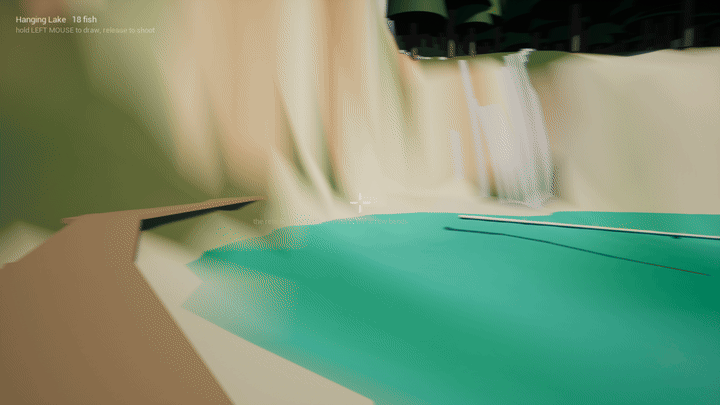
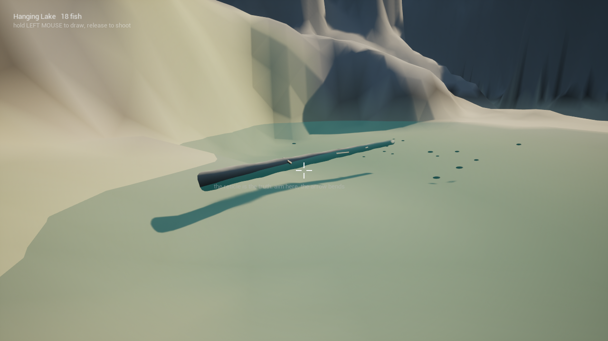
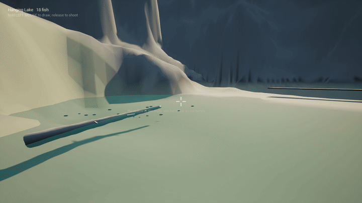
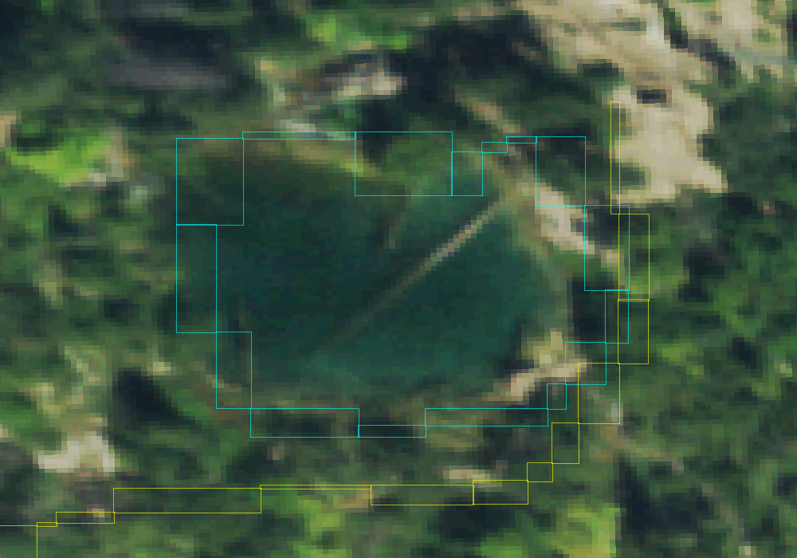

# 🎣 Hanging Lake

A first-person bowfishing game set at Hanging Lake in Glenwood Canyon, Colorado. The
terrain comes from real survey data. You stand on the boardwalk, look across the
famous fallen log, and try to land trout in water that bends light: the fish is
never quite where it looks.







## 🕹️ How to play

You start on the south boardwalk, the postcard view: north across the log to the
falls. Fish cruise the lake; the count is top left. The log can be walked onto from
the travertine shelf at its north-east end, like the real one; step off the side
and you are in the water.

1. Aim at a fish. What you see is its refracted image: straight above the real
   fish and shallower, by a quarter of its depth looking straight down and far
   more the flatter you look. The arrow bends at the surface the way the light
   did, so aim where the fish *looks*. (Launch with `-hlstraightarrow` for a real
   arrow that keeps its line through the water: then you aim under the image, the
   way spearfishers do.)
2. Hold to draw (the bar fills), release to shoot. A full draw flies flattest.
   While you draw, a faint ring marks where your line meets the water.
3. A hit lands the fish and shows its length and depth. Your first catch shows
   where the fish looked to be, where it really was, and the arrow's path.
4. Trout read movement on the bank. Walk up to one and it bolts for deep water;
   hold **Shift** to creep and you can get within a few metres. A splash near a
   fish spooks it too, and every scare makes that fish warier for a while.
5. Arrows stop at the lake bed, the rock, and the log.

| Action | Keyboard and mouse | Controller |
|---|---|---|
| Look | Mouse | Right stick (slower while drawing, for fine aim) |
| Walk | W A S D | Left stick |
| Draw, then release to shoot | Hold left mouse button | Hold right trigger |
| Creep (walk slowly) | Hold Left Shift | Hold left trigger |
| Jump | Space | Bottom face button (A / ✕) |
| Journal | J | Top face button (Y / △) |
| Quit | Esc | Menu / Options button |

### 🎮 Controllers and remapping

Any controller macOS (or Windows) recognises as a gamepad works: Xbox, PlayStation,
Switch Pro, 8BitDo and other MFi or XInput pads. Every control is a named action or
axis in [`game/Config/DefaultInput.ini`](game/Config/DefaultInput.ini), so any key,
button, trigger or stick can be bound to anything:

```ini
+ActionMappings=(ActionName="Draw",Key=Gamepad_RightTrigger)
+ActionMappings=(ActionName="Draw",Key=Gamepad_LeftShoulder)   ; add a second binding
+AxisMappings=(AxisName="LookUpRate",Scale=1.0,Key=Gamepad_RightY) ; invert look
```

Actions: `Draw`, `Sneak`, `Jump`, `Journal`, `Quit`. Axes: `MoveForward`, `MoveRight`, `Turn`, `LookUp`
(mouse), `TurnRate`, `LookUpRate` (sticks). Edit `DefaultInput.ini` for everyone, or
the per-player copy Unreal writes under `game/Saved/Config/<Platform>/Input.ini`.
Unusual devices (flight sticks, wheels, arcade sticks) can be mapped to gamepad
inputs with Steam Input or a tool like Joystick Mapper.

### 📓 The journal

Progress is knowledge, not score. The lake holds the same 18 cutthroat every visit
(a fixed seed places and sizes them), and the journal (**J**) follows each one
through three stages, always in order:

| Stage | How you earn it |
|---|---|
| Observed | Keep the fish near the middle of your view, in clear sight, for a second and a half |
| Stalked | Watch it from within 8 m while it carries on undisturbed, for two seconds |
| Landed | Hit it |

Each stage records the moment: date and time, sun height, the fish's depth, your
distance, and where in the lake it was ("under the log", "below the falls", "off
the boardwalk", "in the deep middle"...). The journal is saved to
`game/Saved/HangingLake/Journal.json` and carries over between sessions.

### 📱 Phones

Not yet. The game runs on desktop Unreal (macOS on Apple Silicon is what it is
tested on). Two routes are open: Unreal's Pixel Streaming, where the game runs on a
computer and streams to a phone's browser with touch controls, or a native iOS or
Android build, which needs a mobile renderer pass and touch controls.

## 🛠️ Run it

Needs **Unreal Engine 5.8** and Git LFS.

```bash
git lfs install
git clone https://github.com/austin80808/hanging-lake.git
cd hanging-lake/game
# Open HangingLake.uproject in Unreal Editor (it builds the C++ module) and press Play,
# or from a terminal on macOS:
"/Users/Shared/Epic Games/UE_5.8/Engine/Build/BatchFiles/Mac/Build.sh" \
  HangingLakeEditor Mac Development -Project="$PWD/HangingLake.uproject"
"/Users/Shared/Epic Games/UE_5.8/Engine/Binaries/Mac/UnrealEditor.app/Contents/MacOS/UnrealEditor" \
  "$PWD/HangingLake.uproject" -game -windowed -ResX=1280 -ResY=720
```

The game reads its terrain from `pipeline/data` beside it (pass `-hldata=<dir>` to
point elsewhere). The first launch compiles shaders and can take a few minutes.

## 🗺️ What is real

| Feature | Source |
|---|---|
| Canyon terrain, 1 m grid | USGS 3DEP lidar elevation |
| Lake outline and surface height | OpenStreetMap way 40199283, 3DEP |
| Lake bed (2.2 m max) | **Authored**: 3DEP has no bathymetry here; a smooth basin fitted to the shoreline |
| Boardwalk and trail | OpenStreetMap, *Hanging Lake Trail* (ways 159737338, 159737337) |
| Falls inflow | OpenStreetMap, East Fork Dead Horse Creek |
| The fallen log | Measured off the USGS NAIP aerial photo: from the north-east rim (39.601460 N, 107.191661 W) south-west to 39.601373 N, 107.191781 W, extended 3.5 m onto the travertine shelf so it meets the bank. Slim, bleached and floating flat, with the row of branch spikes and moss tufts seen in photos |
| Falls, colours, forest | Matched by eye to photos: curtains over the north rim's cream and rust travertine, turquoise water over a pale bed, conifers on the slopes |
| The fish | Cutthroat trout: the lake's own fish are an isolated population of native cutthroat. Numbers, sizes and behaviour are invented |
| Refraction | Snell's law with water at n = 1.333, solved exactly per fish each frame (`HLSnellSolver`) |



Still simple: the falls are static ribbons (no motion or mist), trees are cones, rock
and travertine are vertex colours rather than textures, and there are no aspens,
grasses or reflections yet. The water tints but does not bend light on screen, so the
game moves each fish's visible body to its refracted position itself; the lake bed
is not shifted the same way, so a fish can look a little higher above the bed than
it is. The log's position and angle are surveyed; its shape is
matched by eye.

## 📁 Layout

| Folder | What |
|---|---|
| [`game/`](game) | The Unreal 5.8 C++ project. Gameplay in `Source/HangingLake/`: terrain and lake bed (`HLTerrainData`), water (`HLWaterSurface`), the bow and refraction (`HLBow`, `HLSnellSolver`), fish (`HLFish`), the journal (`HLJournal`), landmarks, lighting and spawn (`HLGameMode`). Engine-free tests in `game/Tests/` |
| [`pipeline/`](pipeline) | Python that builds the terrain data from public sources. See [its README](pipeline/README.md) |
| [`docs/`](docs) | The media above. The design spec is in [`pipeline/docs/`](pipeline/docs/superpowers/specs) |

### Developer switches

Command-line flags for testing (they do nothing unless passed):

| Flag | Does |
|---|---|
| `-hlshot` | Screenshot at 45 s (after shaders finish) |
| `-hlpitch=<deg> -hlyaw=<deg> [-hlpan=<deg/s>]` | Lock (or slowly pan) the view so captures repeat |
| `-hlautoshoot [-hlshootat=<s>]` | Fire four aimed test shots at fish and log hits |
| `-hlautoshoot -hlaimimage` | The same, but aim straight at the image of the nearest still fish within 4.5 m, the way a player would (tests "aim where it looks") |
| `-hlnoimage` | Draw fish where they really are, not where refraction shows them |
| `-hlstraightarrow` | Arrows keep their line through the surface (real physics: aim under the image) |
| `-hljournal=<file>` | Use another journal file (a test can start from an empty one) |
| `-hlquit=<s>` | Quit after that many seconds (for scripted runs) |
| `-hlmaxdepth=<m>` | Rescale the authored lake bed to this maximum depth (default 2.2 m) without re-running the pipeline |
| `-hlwalklog` | Start on the shelf and walk out along the log, logging height over the water |
| `-hlrec=<s> -hlrecdur=<s> -hlrecfps=<n>` | Save frames for a GIF |
| `-hltrace` | Log the camera every 5 s |
| `-hlnoterrain -hlnowater -hlnofish -hlnomat` | Turn pieces off to isolate a problem |
| `-hlev=<bias>` | Exposure bias (default -1) |

## 🧪 Tests

Two checks run without Unreal, so they are safe while the editor is busy with
another project:

```bash
game/Tests/SnellSolver/run.sh        # the aiming maths: HLSnellSolver.cpp built against a tiny Core shim
python3 game/Tests/check_compile.py  # every game .cpp through clang against the installed engine headers
cd pipeline && .venv/bin/python -m pytest tests -q
```

`check_compile.py` reuses the compiler flags Unreal saved at the last real build and
patches the line numbers in stale generated headers, so edits to existing classes
check cleanly. A brand-new `UCLASS`/`USTRUCT` still needs a real build. CI runs the
solver tests and the pipeline tests on every pull request.

When Unreal is free, `game/Tests/play_test.sh` builds the game and plays three short
self-shooting sessions (solver aim, aim at the image, aim at the image with a straight
arrow), then prints hits, misses and journal lines from each log.

## 📜 Data credits

- Elevation: U.S. Geological Survey, 3D Elevation Program (public domain).
- Aerial imagery used to place the log: USDA NAIP via the USGS National Map (public domain).
- Fish: published accounts of the lake describe its trout as an isolated population of
  native cutthroat. The game's numbers, sizes and behaviour are invented.
- Lake outline, trail, boardwalk and streams: © OpenStreetMap contributors, available
  under the [Open Database License](https://www.openstreetmap.org/copyright). The
  cached extracts are in `pipeline/data/cache/`.

Hanging Lake is a protected site run by the U.S. Forest Service and the City of
Glenwood Springs. Fishing and touching the water are not allowed there in real life,
and nobody may walk on the log. This game is the only way to do it.
